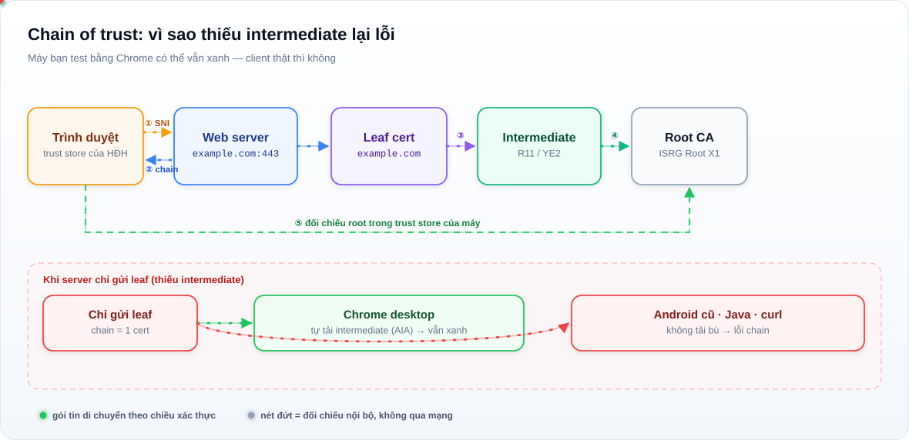
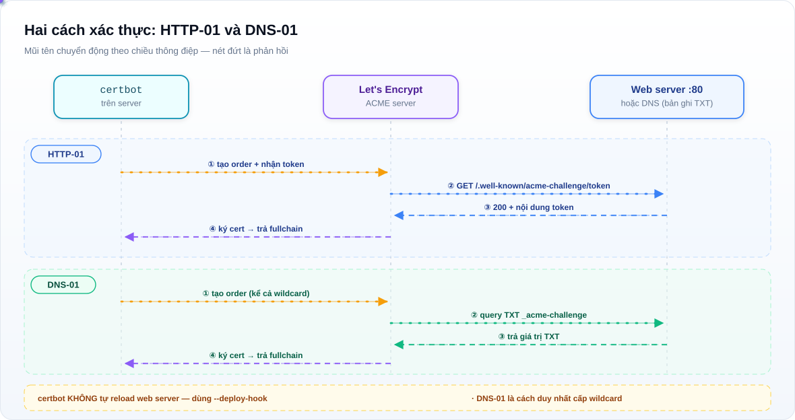

# Cài SSL/TLS: IIS, Apache, nginx, XAMPP và DirectAdmin

Hướng dẫn thực chiến để đưa một website từ `http://` lên `https://` — không phải lý thuyết mật mã,
mà là đúng file nào, đúng dòng nào, và sai thì sửa ở đâu.

<p>
  
  
  
  
  
  
  
  
</p>

---

## Đọc cái này trước

Bài này viết cho người **phải làm cho nó chạy**, thường là trong giờ làm việc và thường là trên
server đang chạy production. Vì vậy nó ưu tiên ba thứ, theo đúng thứ tự:

1. **Không làm sập dịch vụ.** Mọi thay đổi đều có đường lui, và mọi lệnh đều ghi rõ nó có restart
   service hay không.
2. **Kiểm chứng được.** Không có câu "chắc là ổn" — cuối mỗi chương đều có lệnh kiểm tra cho ra
   kết quả đúng/sai rõ ràng.
3. **Hiểu vì sao.** Khi cert hết hạn lúc 2 giờ sáng, hiểu cơ chế sẽ nhanh hơn đọc 40 trang log.

Có bốn nền tảng chính — **nginx**, **Apache trên Linux**, **IIS trên Windows Server**, **XAMPP trên
Windows** — cộng thêm **DirectAdmin** vì rất nhiều server Việt Nam chạy panel này. Cấu hình của
từng nền tảng khác nhau ở chỗ *đặt file ở đâu* và *reload bằng lệnh gì*; phần chứng chỉ, chain và
cách kiểm tra thì giống nhau, nên đọc một lần là dùng được cho cả bốn.

Mọi snippet trong repo là **mẫu để đọc và sửa**, không phải file để copy đè. Đường dẫn, tên miền,
tên file trong đó đều là ví dụ.

---

## Mục lục

- [0. Ba quyết định trước khi bấm cài](#0-ba-quyết-định-trước-khi-bấm-cài)
- [1. Chứng chỉ là gì, dưới góc nhìn người vận hành](#1-chứng-chỉ-là-gì-dưới-góc-nhìn-người-vận-hành)
- [2. Chuẩn bị: DNS, cổng, và chọn nhà cung cấp](#2-chuẩn-bị-dns-cổng-và-chọn-nhà-cung-cấp)
- [3. Let's Encrypt: chọn cách xác thực](#3-lets-encrypt-chọn-cách-xác-thực)
- [4. nginx: cài trong 10 phút](#4-nginx-cài-trong-10-phút)
- [5. Apache trên Linux: hai bản, hai kiểu](#5-apache-trên-linux-hai-bản-hai-kiểu)
- [6. IIS trên Windows Server](#6-iis-trên-windows-server)
- [7. XAMPP trên Windows](#7-xampp-trên-windows)
- [8. DirectAdmin](#8-directadmin)
- [9. Kiểm tra sau khi cài: năm lệnh đủ để tin](#9-kiểm-tra-sau-khi-cài-năm-lệnh-đủ-để-tin)
- [10. Gia hạn tự động và giám sát hạn dùng](#10-gia-hạn-tự-động-và-giám-sát-hạn-dùng)
- [11. Bảng tra lỗi: triệu chứng → nguyên nhân → cách sửa](#11-bảng-tra-lỗi-triệu-chứng--nguyên-nhân--cách-sửa)
- [12. Hardening: từ B lên A+](#12-hardening-từ-b-lên-a)
- [13. Ba sự cố thật và cách xử lý](#13-ba-sự-cố-thật-và-cách-xử-lý)
- [14. Checklist trước khi đóng ticket](#14-checklist-trước-khi-đóng-ticket)
- [15. Câu hỏi thường gặp](#15-câu-hỏi-thường-gặp)
- [16. Thuật ngữ](#16-thuật-ngữ)
- [17. Về repo này](#17-về-repo-này)

Sơ đồ động (SVG, mũi tên chuyển động) ở ngay đầu mỗi chương liên quan — xem nhanh bằng mắt trước
khi đọc chữ.

---

## 0. Ba quyết định trước khi bấm cài

Ba câu hỏi này quyết định 80% công việc phía sau. Trả lời sai thì phải làm lại từ đầu — mà làm lại
thì cert đã cấp rồi, và bạn sẽ đụng rate limit.

### 0.1. Miễn phí hay trả phí?

| | Let's Encrypt / ZeroSSL | Chứng chỉ trả phí (DV/OV/EV) |
|---|---|---|
| Giá | 0 đồng | 500.000 – 10.000.000+ VND/năm |
| Hạn | 90 ngày | 1 năm (một số CA bán 2 năm) |
| Gia hạn | Tự động, phải cấu hình | Tay, hoặc tự động nếu CA có API |
| Thời gian cấp | 30 giây – 2 phút | 5 phút (DV) đến 3–7 ngày (OV/EV) |
| Wildcard | Có, qua DNS-01 | Có, thường tính thêm tiền |
| Bảo hiểm | Không | Có (DV thường 10k–1M USD, chỉ là cam kết, hiếm khi dùng) |
|Thanh tra OV/EV | Không | Có kiểm tra pháp nhân |
| Hiển thị trên trình duyệt | Ổ khoá | Ổ khoá — **giống hệt** |

Sự thật cần nói rõ: **trình duyệt không phân biệt** cert miễn phí với cert trả phí. Cả hai đều cho
ổ khoá xanh và HTTPS. Chứng chỉ trả phí mua uy tín pháp lý (OV/EV), bảo hiểm, và sự yên tâm của
khách hàng doanh nghiệp — không mua "bảo mật tốt hơn".

Chọn Let's Encrypt khi: web thường, có quyền truy cập server, có thể bật cron/timer.
Chọn trả phí khi: khách hàng/đối tác yêu cầu bằng văn bản, cần OV/EV, hoặc server không cho ghi
file vào webroot và không sửa được DNS.

### 0.2. Một tên hay wildcard?

- `example.com` + `www.example.com` → hai tên trong **một** cert (SAN). Dễ nhất, dùng HTTP-01 được.
- `*.example.com` → wildcard, phủ mọi subdomain một cấp. **Bắt buộc DNS-01.** Không phủ
  `example.com` gốc — phải thêm riêng.
- Nhiều domain khác nhau trên một server → một cert nhiều SAN, hoặc nhiều cert. Nhiều cert dễ
  debug hơn, một cert dễ quản lý hơn. Dưới 10 tên thì gộp thoải mái.

Lưu ý wildcard: `*.example.com` **không** phủ `a.b.example.com`. Nếu có subdomain hai cấp, phải
thêm `*.b.example.com` hoặc tên cụ thể.

### 0.3. Ai gia hạn, và khi nào ta biết nó hỏng?

Đây là câu hỏi bị bỏ qua nhiều nhất, và là nguyên nhân của phần lớn sự cố cert hết hạn.

Trước khi cài, trả lời được ba dòng này:

1. Cert sống 90 ngày. Gia hạn tự động chạy ở đâu — cron của root, systemd timer, scheduled task
   của Windows, hay panel?
2. Ai nhận thông báo khi gia hạn thất bại? (Email certbot gửi cho ai? Có ai đọc không?)
3. Có chỗ nào nhìn được **số ngày còn lại** mà không cần SSH không? (Dashboard, script, Zabbix...)

Không trả lời được câu 1 thì đừng cài. Cert hết hạn trên production tệ hơn nhiều so với việc mất
10 phút cấu hình timer ngay từ đầu.

---

## 1. Chứng chỉ là gì, dưới góc nhìn người vận hành

Bỏ qua phần toán học. Cần nhớ đúng bốn thứ.

### 1.1. Cặp khoá và file nào là file nào

Chứng chỉ TLS là **một cặp**: khoá công khai (nằm trong cert, ai cũng xem được) và khoá riêng tư
(file `.key`, không được rời khỏi server). Cert do CA ký để chứng minh "khoá công khai này thuộc
về tên miền này".

Người mới hay lẫn vì mỗi CA đặt tên một kiểu:

| Đuôi file | Là gì | Có bí mật? | Dùng ở đâu |
|---|---|---|---|
| `.key` | Khoá riêng tư | **Có — tuyệt đối** | Chỉ web server đọc |
| `.crt` / `.cer` / `.pem` | Chứng chỉ (có thể kèm chain) | Không | Cấu hình server |
| `.csr` | Yêu cầu ký, sinh từ `.key` | Không (nhưng đừng đăng bừa) | Gửi cho CA |
| `.pfx` / `.p12` | Gói cert + key + chain, có mật khẩu | **Có** | IIS, Java, Windows |
| `.p7b` | Chỉ cert + chain, không có key | Không | Import vào Windows/IIS |
| `fullchain.pem` | Cert + toàn bộ intermediate | Không | nginx, Apache 2.4.8+ |
| `chain.pem` | Chỉ intermediate | Không | OCSP stapling, Apache cũ |

Quy tắc thực dụng: **`fullchain` cho web server, `privkey` cho web server, không thứ gì khác.**

### 1.2. Chain of trust — chỗ hay sai nhất

Trình duyệt không tin cert của bạn. Nó tin **root CA** nằm sẵn trong hệ điều hành. Ở giữa là
**intermediate CA** do root ký. Server phải gửi cert của bạn **kèm intermediate**; trình duyệt tự
nối tới root.

Thiếu intermediate → Chrome trên desktop có thể vẫn chạy (nó tự tải intermediate về bù), nhưng
**Android cũ, Java client, curl, ứng dụng mobile, và máy POS sẽ báo lỗi**. Đây là loại lỗi tệ nhất
vì nó không tái hiện được trên máy bạn.



Kiểm tra bằng mắt: mở cert trên trình duyệt, xem tab "Certification Path" — phải có 3 mức
(leaf → intermediate → root). Chỉ có 2 mức nghĩa là thiếu intermediate.

### 1.3. Cert hết hạn theo **giờ UTC**, và đồng hồ server phải đúng

Chứng chỉ có `notBefore` và `notAfter` chính xác tới giây. Hai cái bẫy:

- Server lệch giờ (timezone sai, NTP không chạy, VM bị suspend lâu) → cert "chưa có hiệu lực"
  dù vừa cấp xong.
- Cert gia hạn xong nhưng **service chưa reload** → vẫn dùng cert cũ trong bộ nhớ tới khi restart.

### 1.4. HTTPS không làm web nhanh hơn, và không che lỗi bảo mật khác

HTTPS mã hoá đường truyền. Nó không vá SQL injection, không chặn admin panel lộ, không thay được
tường lửa. Cert hợp lệ chỉ nghĩa là "kênh này không bị nghe trộm và không bị giả mạo". Đừng để
việc có ổ khoá xanh tạo cảm giác an toàn giả.

---

## 2. Chuẩn bị: DNS, cổng, và chọn nhà cung cấp

### 2.1. DNS phải đúng trước khi xin cert

CA sẽ kiểm tra bạn sở hữu tên miền bằng cách truy vấn DNS công cộng. Làm sai bước này là nguyên
nhân số một của lỗi `DNS problem: NXDOMAIN`.

```bash
# Phải trả về đúng IP của server, từ ngoài Internet
dig +short example.com A
dig +short www.example.com A

# Kiểm tra từ một resolver công cộng, không phải resolver nội bộ
dig +short @1.1.1.1 example.com A
dig +short @8.8.8.8 example.com A
```

Ba điều kiện:

1. Bản ghi `A` (hoặc `AAAA` nếu có IPv6) trỏ đúng IP server.
2. Không có nhiều bản ghi A trỏ lung tung — CA có thể kiểm tra nhầm server khác.
3. Nếu dùng Cloudflare ở chế độ **proxy (đám mây cam)**, HTTP-01 sẽ thất bại vì request tới
   Cloudflare chứ không tới server bạn. Chuyển sang **DNS only (đám mây xám)** trong lúc xin cert,
   hoặc dùng DNS-01.

### 2.2. Cổng 80 và 443 phải mở từ Internet

```bash
# Trên server: có gì đang nghe?
sudo ss -lntp | grep -E ':(80|443)\b'

# Từ máy ngoài: có vào được không? (dùng một máy khác, không phải chính server)
curl -sS -o /dev/null -w '%{http_code}\n' http://example.com/
```

Nếu có tường lửa (ufw, firewalld, iptables, cloud security group, NAT của router), mở **cả 80 và
443**. HTTP-01 bắt buộc cần 80. Nhiều nơi chỉ mở 443 rồi ngồi đoán tại sao certbot báo timeout.

### 2.3. Chọn CA

| CA | Giao diện | Wildcard | Ghi chú |
|---|---|---|---|
| Let's Encrypt | certbot, acme.sh, panel | Có (DNS-01) | Mặc định nên dùng. Miễn phí, phổ biến nhất |
| ZeroSSL | Web + ACME | Có | Có giao diện web, hợp khi không muốn dùng CLI |
| Buypass | ACME | Có | Hạn 180 ngày, ít dùng ở VN |
| Google Trust Services | ACME | Có | Mới hơn, cần đăng ký |

Với Let's Encrypt, nhớ **rate limit** để không tự khoá mình:

- 50 cert / domain đã đăng ký / 7 ngày
- 5 cert **trùng** (cùng tập tên) / 7 ngày
- 300 đơn mới / 3 giờ / tài khoản
- 5 lần thất bại xác thực / tên / giờ

Nghĩa là: đừng thử đi thử lại 10 lần trên production. Dùng **staging** để thử:

```bash
# Luôn thử ở staging trước khi làm thật
sudo certbot certonly --staging -d example.com -d www.example.com --webroot -w /var/www/html
```

Staging cấp cert không được tin — đúng mục đích: kiểm tra luồng có chạy không, không đụng rate limit.

---

## 3. Let's Encrypt: chọn cách xác thực

ACME cần chứng minh bạn kiểm soát tên miền. Ba cách, chọn theo bảng dưới.



| | HTTP-01 | DNS-01 | TLS-ALPN-01 |
|---|---|---|---|
| Cần gì | File trong webroot, cổng 80 mở | Quyền sửa bản ghi DNS | Cổng 443 mở, server tự xử lý |
| Wildcard | **Không** | **Có** | Không |
| Chạy sau CDN/proxy | Không | Có | Không |
| Cần downtime | Không | Không | Không |
| Tự động hoá | Rất dễ | Cần plugin DNS | Trung bình |
| Hợp khi | Web thường, có quyền server | Wildcard, nhiều subdomain, sau Cloudflare | Ít dùng, certbot có hỗ trợ |

### 3.1. HTTP-01 — mặc định nên chọn

CA đưa cho client một token; client ghi file vào
`http://example.com/.well-known/acme-challenge/<token>`; CA tải file đó về kiểm tra.

```bash
# Kiểm tra thư mục challenge có truy cập được từ ngoài chưa
# (thay token bằng chuỗi bất kỳ để thử)
echo "test-ok" | sudo tee /var/www/html/.well-known/acme-challenge/test
curl -sS http://example.com/.well-known/acme-challenge/test
# Phải in ra: test-ok
```

Nếu lệnh `curl` ở trên trả 404 hoặc 403, đừng chạy certbot — sửa web server trước.

**Cạm bẫy HTTP-01 hay gặp:**

- Redirect toàn bộ HTTP sang HTTPS trước khi có cert → challenge bị redirect, CA không theo được
  (Let's Encrypt **có** theo redirect, nhưng chỉ tới HTTPS hợp lệ — vòng tròn bất khả thi).
  Cách đúng: cho phép `.well-known/acme-challenge/` đi qua HTTP.
- `.htaccess` hoặc rule rewrite chặn đường dẫn bắt đầu bằng dấu chấm.
- `webroot` trỏ sai thư mục: phải là thư mục **chứa** `.well-known`, không phải thư mục chứa
  `index.php` nếu web root nằm sâu hơn (ví dụ Laravel `public/`).

### 3.2. DNS-01 — khi cần wildcard

CA yêu cầu một bản ghi `TXT` tại `_acme-challenge.example.com`. Client tạo bản ghi, chờ DNS lan
truyền, CA kiểm tra, xong thì xoá.

```bash
# Kiểm tra bản ghi TXT đã lan truyền chưa (trước khi bấm xác thực)
dig +short TXT _acme-challenge.example.com @1.1.1.1
```

Ưu điểm lớn: **không cần mở cổng 80**, chạy được sau CDN, chạy được cho server nội bộ không có IP
công cộng (chỉ cần một máy khác trong mạng chạy certbot).

Nhược điểm: cần quyền API của nhà cung cấp DNS. Nếu DNS do khách hàng quản lý và họ không cho API
key, thì DNS-01 không khả thi — quay lại HTTP-01.

Cấu hình DNS-01 với certbot cần plugin theo từng nhà cung cấp:

```bash
# Ví dụ Cloudflare
sudo apt install python3-certbot-dns-cloudflare
sudo install -m 600 /dev/null /root/.secrets/cloudflare.ini
# Nội dung file: dns_cloudflare_api_token = <token chỉ có quyền DNS:Edit>
sudo certbot certonly --dns-cloudflare \
  --dns-cloudflare-credentials /root/.secrets/cloudflare.ini \
  -d example.com -d '*.example.com'
```

Token DNS nên là token **giới hạn quyền** (chỉ zone đó, chỉ DNS:Edit), không phải Global API Key.
File credentials phải `chmod 600`, và nhớ nó không nằm trong repo.

### 3.3. Chọn webroot hay plugin của web server?

`certbot --nginx` và `--apache` **tự sửa file cấu hình** của bạn. Tiện, nhưng:

- Nó chèn block vào chỗ nó muốn; lần sau bạn sửa tay có thể xung đột.
- Nó không biết về cấu trúc include, template, hay file do panel quản lý.
- Trên server có nhiều người sửa config, thay đổi tự động khó truy vết.

Khuyến nghị: dùng `certonly --webroot` (hoặc DNS-01), rồi **tự viết** block 443 một lần. Bạn kiểm
soát hoàn toàn, và certbot chỉ làm đúng một việc là lấy cert. Ngoại lệ: server cá nhân, một site,
không ai khác sửa — `--nginx` cho nhanh.

## 4. nginx: cài trong 10 phút

Giả định: Ubuntu 22.04/24.04, web root `/var/www/example.com/public`, chạy bằng `root` hoặc sudo.

### 4.1. Cài và mở cổng

```bash
sudo apt update
sudo apt install -y nginx certbot python3-certbot-nginx

sudo ufw allow 'Nginx Full'      # mở 80 + 443
sudo ufw status
```

Trên RHEL/Rocky/Alma:

```bash
sudo dnf install -y nginx certbot python3-certbot-nginx
sudo firewall-cmd --permanent --add-service=http --add-service=https
sudo firewall-cmd --reload
```

### 4.2. Lấy cert (không để certbot sửa config)

```bash
# Lần đầu: thử staging
sudo certbot certonly --staging --webroot -w /var/www/example.com/public \
  -d example.com -d www.example.com

# Thấy OK rồi thì làm thật (xoá --staging)
sudo certbot certonly --webroot -w /var/www/example.com/public \
  -d example.com -d www.example.com
```

Kết quả nằm ở:

```
/etc/letsencrypt/live/example.com/fullchain.pem   <- cert + intermediate
/etc/letsencrypt/live/example.com/privkey.pem     <- khoá riêng tư
/etc/letsencrypt/live/example.com/chain.pem       <- chỉ intermediate
```

`/etc/letsencrypt/live/...` là **symlink** sang `/etc/letsencrypt/archive/...`. Luôn trỏ cấu hình
vào đường dẫn `live/` — khi gia hạn, symlink được cập nhật, còn file trong `archive/` có tên kèm số
thứ tự và sẽ thay đổi.

### 4.3. Block server 443

Tạo `/etc/nginx/sites-available/example.com`:

```nginx
# HTTP: chỉ để redirect và trả challenge
server {
    listen 80;
    listen [::]:80;
    server_name example.com www.example.com;

    # Cho ACME đi qua, KHÔNG redirect block này
    location ^~ /.well-known/acme-challenge/ {
        root /var/www/example.com/public;
        default_type text/plain;
        try_files $uri =404;
    }

    location / {
        return 301 https://$host$request_uri;
    }
}

server {
    listen 443 ssl;
    listen [::]:443 ssl;
    http2 on;                       # nginx >= 1.25.1
    server_name example.com www.example.com;

    ssl_certificate     /etc/letsencrypt/live/example.com/fullchain.pem;
    ssl_certificate_key /etc/letsencrypt/live/example.com/privkey.pem;

    # Bộ tham số chuẩn của certbot (protocol, cipher, session, OCSP)
    include /etc/letsencrypt/options-ssl-nginx.conf;
    ssl_dhparam /etc/letsencrypt/ssl-dhparams.pem;

    root  /var/www/example.com/public;
    index index.php index.html;

    access_log /var/log/nginx/example.com.access.log;
    error_log  /var/log/nginx/example.com.error.log;

    location / {
        try_files $uri $uri/ /index.php?$query_string;
    }

    location ~ \.php$ {
        include snippets/fastcgi-php.conf;
        fastcgi_pass unix:/run/php/php8.3-fpm.sock;
    }
}
```

Ba chi tiết dễ sai:

- **`http2 on;`** chỉ có từ nginx 1.25.1. Bản cũ hơn dùng `listen 443 ssl http2;` — nếu viết sai
  kiểu, nginx báo `unknown directive "http2"` và **không reload**, nhưng config cũ vẫn chạy, nên
  tưởng là đã xong.
- **Không đặt `ssl on;`** — directive này đã bị bỏ từ nginx 1.15.
- `include /etc/letsencrypt/options-ssl-nginx.conf` do certbot tạo. Nếu file không tồn tại (vì bạn
  dùng `certonly` trên máy chưa từng chạy plugin nginx), tự viết phần hardening ở
  [chương 12](#12-hardening-từ-b-lên-a) hoặc bỏ dòng include.

### 4.4. Bật site và reload

```bash
sudo ln -s /etc/nginx/sites-available/example.com /etc/nginx/sites-enabled/
sudo rm -f /etc/nginx/sites-enabled/default     # nếu không dùng

sudo nginx -t          # PHẢI thấy: syntax is ok / test is successful
sudo systemctl reload nginx
```

`nginx -t` là bắt buộc, không phải tuỳ chọn. `reload` giữ kết nối đang mở; `restart` thì cắt. Trên
production luôn `reload`.

### 4.5. Riêng RHEL/CentOS: SELinux

Đây là lý do số một khiến "cấu hình đúng mà vẫn 403" trên RHEL:

```bash
# Cert nằm ngoài /etc/pki/tls sẽ bị SELinux chặn
sudo semanage fcontext -a -t cert_t "/etc/letsencrypt(/.*)?"
sudo restorecon -Rv /etc/letsencrypt

# nginx có được phép nối ra ngoài (OCSP stapling)?
sudo setsebool -P httpd_can_network_connect 1

# Xem có gì bị chặn
sudo ausearch -m avc -ts recent
```

---

## 5. Apache trên Linux: hai bản, hai kiểu

Apache có hai "trường phái" cấu hình khác nhau, và lẫn giữa chúng là nguồn gốc của rất nhiều lỗi.

| | Debian/Ubuntu | RHEL/Rocky/Alma |
|---|---|---|
| Tên service | `apache2` | `httpd` |
| Thư mục config chính | `/etc/apache2/` | `/etc/httpd/` |
| Site | `sites-available/` + `a2ensite` | `conf.d/*.conf` (tự load) |
| Module | `a2enmod ssl` | có sẵn trong `mod_ssl` |
| Test config | `apache2ctl configtest` | `httpd -t` |
| Reload | `systemctl reload apache2` | `systemctl reload httpd` |

### 5.1. Debian/Ubuntu

```bash
sudo apt install -y apache2 certbot
sudo a2enmod ssl headers rewrite
sudo systemctl reload apache2

# Lấy cert
sudo certbot certonly --webroot -w /var/www/example.com/public \
  -d example.com -d www.example.com
```

`/etc/apache2/sites-available/example.com.conf`:

```apache
<VirtualHost *:80>
    ServerName example.com
    ServerAlias www.example.com
    DocumentRoot /var/www/example.com/public

    # ACME phải đi qua HTTP
    Alias /.well-known/acme-challenge/ /var/www/example.com/public/.well-known/acme-challenge/
    <Directory "/var/www/example.com/public/.well-known/acme-challenge/">
        Require all granted
        Options -Indexes
    </Directory>

    RewriteEngine On
    RewriteCond %{REQUEST_URI} !^/\.well-known/acme-challenge/
    RewriteRule ^ https://%{HTTP_HOST}%{REQUEST_URI} [R=301,L]
</VirtualHost>

<VirtualHost *:443>
    ServerName example.com
    ServerAlias www.example.com
    DocumentRoot /var/www/example.com/public

    SSLEngine on
    # Apache 2.4.8+: chain nằm LUÔN trong SSLCertificateFile
    SSLCertificateFile      /etc/letsencrypt/live/example.com/fullchain.pem
    SSLCertificateKeyFile   /etc/letsencrypt/live/example.com/privkey.pem

    <Directory "/var/www/example.com/public">
        AllowOverride All
        Require all granted
    </Directory>

    ErrorLog  ${APACHE_LOG_DIR}/example.com.error.log
    CustomLog ${APACHE_LOG_DIR}/example.com.access.log combined
</VirtualHost>
```

```bash
sudo a2ensite example.com
sudo a2dissite 000-default      # nếu không dùng
sudo apache2ctl configtest      # PHẢI: Syntax OK
sudo systemctl reload apache2
```

### 5.2. `SSLCertificateChainFile` — cái bẫy lớn nhất của Apache

Tài liệu và blog cũ (và cả nhiều file mẫu còn nằm trên server) dùng:

```apache
SSLCertificateFile    /path/cert.pem
SSLCertificateKeyFile /path/key.pem
SSLCertificateChainFile /path/chain.pem     # KIỂU CŨ
```

Từ **Apache 2.4.8**, `SSLCertificateChainFile` bị **deprecated**. Cách đúng hiện nay là **nối chain
vào sau cert** trong cùng một file:

```bash
cat cert.pem chain.pem > fullchain.pem
```

rồi chỉ khai báo:

```apache
SSLCertificateFile    /path/fullchain.pem
SSLCertificateKeyFile /path/key.pem
```

Nếu bạn để cả hai, Apache vẫn chạy nhưng có thể gửi **hai lần** intermediate hoặc gửi sai thứ tự,
khiến một số client báo lỗi chain. Kiểm tra bằng `openssl s_client` ở chương 9.

**Thứ tự trong `fullchain.pem` rất quan trọng:** cert của bạn trước, intermediate sau, root **không**
được đưa vào (nhiều client coi root trong chain là lỗi).

### 5.3. RHEL/Rocky

```bash
sudo dnf install -y httpd mod_ssl certbot
sudo systemctl enable --now httpd

sudo certbot certonly --webroot -w /var/www/html -d example.com -d www.example.com
```

`/etc/httpd/conf.d/example.com.conf`:

```apache
<VirtualHost *:80>
    ServerName example.com
    ServerAlias www.example.com
    DocumentRoot /var/www/html

    <Directory "/var/www/html">
        AllowOverride All
        Require all granted
    </Directory>

    RewriteEngine On
    RewriteCond %{REQUEST_URI} !^/\.well-known/acme-challenge/
    RewriteRule ^ https://%{HTTP_HOST}%{REQUEST_URI} [R=301,L]
</VirtualHost>

<VirtualHost *:443>
    ServerName example.com
    ServerAlias www.example.com
    DocumentRoot /var/www/html

    SSLEngine on
    SSLCertificateFile    /etc/letsencrypt/live/example.com/fullchain.pem
    SSLCertificateKeyFile /etc/letsencrypt/live/example.com/privkey.pem

    <Directory "/var/www/html">
        AllowOverride All
        Require all granted
    </Directory>
</VirtualHost>
```

```bash
sudo httpd -t
sudo systemctl reload httpd
```

**SELinux trên RHEL** — cert ngoài `/etc/pki/tls` sẽ bị chặn:

```bash
sudo semanage fcontext -a -t cert_t "/etc/letsencrypt(/.*)?"
sudo restorecon -Rv /etc/letsencrypt
sudo ausearch -m avc -ts recent      # xem có gì bị chặn
```

Nếu Apache không khởi động được sau khi thêm `SSLEngine on`, xem ngay:

```bash
sudo journalctl -u httpd -n 30 --no-pager
```

Lỗi hay gặp: `Invalid command 'SSLEngine'` → chưa cài `mod_ssl`. `Unable to configure RSA server
private key` → file key sai hoặc quyền sai (phải `600`, chủ sở hữu `root`).

---

## 6. IIS trên Windows Server

IIS không có khái niệm "file cấu hình cert" như nginx. Cert được **import vào Windows Certificate
Store**, rồi **binding** của site trỏ tới cert đó. Đây là điểm khác biệt lớn nhất về tư duy.

### 6.1. Ba cách làm, chọn một

| Cách | Hợp với | Gia hạn tự động |
|---|---|---|
| **win-acme** (CLI, miễn phí) | Server nhiều site, thích script | Có, tạo Scheduled Task |
| **Certify The Web** (GUI) | Cần giao diện, ít site | Có |
| **Mua cert + import PFX tay** | Khách yêu cầu OV/EV | Không (phải làm tay) |

Phần dưới hướng dẫn **win-acme** vì nó phổ biến, miễn phí, và không cần cài .NET runtime mới.

### 6.2. win-acme: cài và chạy

1. Tải bản `win-acme.v2.x.x.x64.pluggable.zip` từ GitHub release, giải nén vào
   `C:\win-acme` (đường dẫn **không có dấu cách** — tránh lỗi đường dẫn trong task scheduler).
2. Mở **Command Prompt as Administrator**, không phải PowerShell (bản PowerShell có thể bị
   ExecutionPolicy chặn script con).
3. Chạy:

```cmd
cd C:\win-acme
wacs.exe
```

Menu tương tác. Chọn theo thứ tự:

```
M: Create certificate (full options)
  → Manual input       (nhập tên miền)
  → example.com, www.example.com
  → [Enter] để chấp nhận
  → Single certificate (một cert cho tất cả tên)   ← khuyến nghị
  → [Enter] (key RSA 2048)
  → [Enter] (lưu vào store mặc định)
  → IIS          ← validation dùng site IIS có sẵn (HTTP-01)
  → chọn site
  → [Enter] (path cho file .well-known)
  → [Enter] (store: Web Hosting)
  → [Enter] (installation: IIS)
  → chọn site cần gắn cert
  → [Enter] (binding mới, port 443, SNI)
```

win-acme làm ba việc: lấy cert, import vào store, và **tạo Scheduled Task** chạy 2 lần/ngày để gia
hạn. Kiểm tra task:

```cmd
schtasks /query /tn "win-acme*" /fo LIST
```

### 6.3. Làm tay: import PFX và binding

Khi mua cert, CA thường gửi một file `.pfx` (hoặc `.crt` + `.ca-bundle` để bạn tự gộp). Cách gộp
bằng OpenSSL (có sẵn trong Git for Windows):

```bash
openssl pkcs12 -export -out example.pfx \
  -inkey example.key -in example.crt -certfile ca-bundle.crt
```

Import:

1. `Win + R` → `mmc` → File → Add/Remove Snap-in → **Certificates** → **Computer account** →
   Local computer.
2. Chuột phải **Personal → Certificates** → All Tasks → **Import** → chọn `.pfx` → nhập mật khẩu →
   tick **"Mark this key as exportable"** (chỉ khi cần backup) và **"Include all extended
   properties"**.
3. Kiểm tra cert có chain đầy đủ: mở cert → tab **Certification Path** → phải thấy 3 mức.

Gắn vào site:

1. IIS Manager → site → **Bindings** → Add.
2. Type `https`, Port `443`, Host name `example.com` (**phải khớp SAN trong cert**).
3. Tick **Require Server Name Indication** nếu server có nhiều site trên cùng IP.
4. SSL certificate → chọn cert vừa import.

Làm lại bước 3–4 cho `www.example.com` nếu đó là binding riêng.

### 6.4. Ba lỗi IIS hay gặp

**a) Cert không hiện trong dropdown chọn binding.** IIS chỉ liệt kê cert có **private key** trong
store `Local Computer\Personal`. Nếu import vào `Current User`, hoặc import thiếu key (chỉ `.crt`),
cert sẽ không xuất hiện. Sửa: import lại `.pfx` có key, vào `Local Computer`.

**b) `netsh http show sslcert` cho thấy binding cũ vẫn còn sau khi đổi cert.** IIS cache SSL
binding theo `hostname:port`. Sau khi gắn cert mới, nếu vẫn thấy cert cũ:

```cmd
netsh http show sslcert hostnameport=example.com:443
```

`iisreset` sẽ xoá cache nhưng **cắt toàn bộ kết nối** — chỉ làm trong cửa sổ bảo trì. Cách nhẹ hơn:
xoá và tạo lại binding trong IIS Manager (thao tác này chỉ ảnh hưởng site đó).

**c) Windows Server cũ không bật TLS 1.2.** Windows Server 2008 R2 / 2012 (chưa cập nhật) mặc định
chỉ bật SSL 3.0 và TLS 1.0, khiến Chrome/Firefox hiện đại báo
`ERR_SSL_VERSION_OR_CIPHER_MISMATCH`. Bật bằng registry hoặc bằng công cụ **IIS Crypto** (Nartac) —
chọn preset "Best Practices", tick TLS 1.2, **bỏ** SSL 2.0/3.0, reboot.

Trước khi reboot, luôn kiểm tra RDP vẫn dùng được — tắt TLS 1.0 có thể ảnh hưởng client RDP cũ.
Có console/IPMI/KVM trước khi reboot là bắt buộc.

### 6.5. Firewall và kiểm tra

```powershell
New-NetFirewallRule -DisplayName "HTTPS 443" -Direction Inbound -Protocol TCP -LocalPort 443 -Action Allow
```

Nếu dùng NAT/router, forward 443 vào đúng IP nội bộ của server.

---

## 7. XAMPP trên Windows

XAMPP là Apache + PHP + MySQL đóng gói cho máy cá nhân. Nó **không** có cơ chế gia hạn cert, không
có panel quản lý, và mặc định không bật SSL. Đây là môi trường dev — nhưng đôi khi người ta dùng
nó để chạy web thật, nên chương này nói cả hai.

### 7.1. Trước tiên: bạn cần cert cho việc gì?

| Mục đích | Cách làm |
|---|---|
| Dev `localhost`, cần HTTPS để test cookie `Secure`, service worker | Self-signed (mục 7.2) — chấp nhận cảnh báo trình duyệt |
| Dev trong LAN, nhiều máy truy cập | Self-signed + cài root CA vào từng máy, hoặc dùng `mkcert` |
| Web thật, có tên miền công khai | **Đừng dùng XAMPP.** Dùng win-acme để lấy cert rồi trỏ Apache của XAMPP vào (mục 7.4) |

### 7.2. Self-signed cho dev

XAMPP có sẵn OpenSSL tại `C:\xampp\apache\bin\openssl.exe`.

```cmd
cd C:\xampp\apache\bin

openssl req -x509 -nodes -days 825 -newkey rsa:2048 ^
  -keyout C:\xampp\apache\conf\ssl.key\server.key ^
  -out C:\xampp\apache\conf\ssl.crt\server.crt ^
  -subj "/CN=localhost" ^
  -addext "subjectAltName=DNS:localhost,IP:127.0.0.1"
```

`-addext subjectAltName` là phần quan trọng: trình duyệt hiện đại **bỏ qua** `CN`, chỉ đọc SAN.
Thiếu SAN thì cert đúng tên vẫn báo `ERR_CERT_COMMON_NAME_INVALID`.

### 7.3. Bật SSL trong Apache của XAMPP

Mở `C:\xampp\apache\conf\httpd.conf`, bỏ dấu `#` ở hai dòng:

```apache
LoadModule ssl_module modules/mod_ssl.so
Include conf/extra/httpd-ssl.conf
```

Rồi sửa `C:\xampp\apache\conf\extra\httpd-ssl.conf`:

```apache
Listen 443

SSLCipherSuite HIGH:MEDIUM:!MD5:!RC4:!3DES
SSLProxyCipherSuite HIGH:MEDIUM:!MD5:!RC4:!3DES

SSLHonorCipherOrder on
SSLProtocol all -SSLv3 -TLSv1 -TLSv1.1
SSLSessionCache "shmcb:logs/ssl_scache(512000)"
SSLSessionCacheTimeout 300

<VirtualHost _default_:443>
    DocumentRoot "C:/xampp/htdocs"
    ServerName localhost:443
    ServerAdmin admin@localhost
    ErrorLog "logs/error.log"
    TransferLog "logs/access.log"

    SSLEngine on
    SSLCertificateFile      "C:/xampp/apache/conf/ssl.crt/server.crt"
    SSLCertificateKeyFile   "C:/xampp/apache/conf/ssl.key/server.key"

    <FilesMatch "\.(cgi|shtml|phtml|php)$">
        SSLOptions +StdEnvVars
    </FilesMatch>
    <Directory "C:/xampp/cgi-bin">
        SSLOptions +StdEnvVars
    </Directory>

    BrowserMatch "MSIE [2-5]" nokeepalive ssl-unclean-shutdown
</VirtualHost>
```

Ba điều dễ sai trên Windows:

- **Dùng dấu `/` trong đường dẫn**, không dùng `\`. Apache trên Windows chấp nhận `/` và tránh được
  lỗi escape (`\s` bị hiểu là ký tự đặc biệt).
- **Đường dẫn có dấu cách** (`C:\Program Files\...`) phải đặt trong ngoặc kép, và một số directive
  như `SSLSessionCache` vẫn lỗi — lý do nên để cert trong `C:\xampp\apache\conf\` như trên.
- **`SSLSessionCache`** dùng đường dẫn tương đối `logs/...`. Nếu Apache báo
  `SSLSessionCache: Invalid argument`, đổi thành đường dẫn tuyệt đối
  `"shmcb:C:/xampp/apache/logs/ssl_scache(512000)"`.

Khởi động lại:

```cmd
C:\xampp\apache\bin\httpd.exe -t
C:\xampp\apache\bin\httpd.exe -k restart
```

Hoặc dùng XAMPP Control Panel → Stop/Start Apache. Nếu Apache không lên, xem
`C:\xampp\apache\logs\error.log`.

### 7.4. Lỗi "Apache không khởi động được" — 90% là trùng cổng 443

```cmd
netstat -ano | findstr :443
```

Nếu có PID, xem nó là gì:

```cmd
tasklist /FI "PID eq <PID>"
```

Thủ phạm thường gặp: **IIS** (site mặc định), **Skype** (dùng 443 làm fallback), **VMware
Workstation** (port sharing), **Visual Studio** (IIS Express). Sửa: tắt dịch vụ đó, hoặc đổi cổng
SSL của XAMPP sang 4443 và truy cập `https://localhost:4443`.

### 7.5. Web thật chạy trên XAMPP

Không nên, nhưng nếu buộc phải: lấy cert bằng **win-acme** (mục 6.2) với validation kiểu `manual`
hoặc `filesystem`, nó sẽ cho ra `fullchain.pem` + `privkey.pem`. Trỏ Apache vào:

```apache
SSLCertificateFile    "C:/certs/fullchain.pem"
SSLCertificateKeyFile "C:/certs/privkey.pem"
```

Và **tự làm cron gia hạn**: win-acme có thể chạy ở chế độ `--installation none` để chỉ renew + copy
file vào `C:\certs`, sau đó một Scheduled Task khác restart Apache. Đây là lý do nên dùng IIS hoặc
nginx cho web thật — XAMPP không được thiết kế cho việc này.

---

## 8. DirectAdmin

DirectAdmin có Let's Encrypt tích hợp. Với 90% trường hợp, chỉ cần tick một ô.

### 8.1. Bật Let's Encrypt qua giao diện

1. Đăng nhập **user** của domain (không phải admin).
2. **Domain Setup** → chọn domain → **SSL Certificates**.
3. Tick **"Use Let's Encrypt"** (hoặc "Free & automatic certificate from Let's Encrypt").
4. Chọn **"Save"**. DA sẽ tự xác thực qua HTTP-01 và cài cert.
5. Tick **"Force HTTPS"** nếu muốn redirect toàn bộ.

DA tự gia hạn, tự reload Apache/nginx. Không cần cron riêng, không cần certbot.

Nếu bật Force HTTPS mà web bị vòng lặp redirect: kiểm tra `options.conf` xem
`force_hostname` / `redirect` có đang bật cùng lúc không, và kiểm tra `.htaccess` của ứng dụng có
redirect theo cách riêng.

### 8.2. Cài cert mua (OV/EV) trên DirectAdmin

1. **SSL Certificates** → dán nội dung **Certificate** (cert của bạn, kèm chain nếu có).
2. Dán **Private Key**.
3. Dán **CA Certificate** (intermediate) — nếu CA gửi file `ca-bundle`, dán toàn bộ nội dung.
4. Save.

DA lưu cert trong `/usr/local/directadmin/data/users/<user>/domains/<domain>.cert` và key trong
`...key`. **Đừng sửa tay các file này** — dùng giao diện hoặc `da` CLI, vì DA sẽ ghi đè khi rebuild.

### 8.3. Kiểm tra

```bash
# Xem cert DA đang phục vụ
openssl s_client -connect example.com:443 -servername example.com </dev/null 2>/dev/null \
  | openssl x509 -noout -subject -issuer -dates

# Kiểm tra redirect HTTP -> HTTPS
curl -sSI http://example.com | head -3
```

### 8.4. Khi DA báo lỗi cấp cert

| Thông báo | Nguyên nhân thường gặp |
|---|---|
| `Challenge failed` / `Invalid response` | Domain chưa trỏ đúng server, hoặc `.htaccess` chặn `/.well-known/` |
| `too many failed authorizations` | Đã thử quá nhiều lần, chờ 1 giờ |
| `DNS problem: NXDOMAIN` | Bản ghi A chưa có hoặc chưa lan truyền |
| Cert cấp xong nhưng trình duyệt vẫn báo cũ | Chưa reload, hoặc CDN đang cache cert cũ |

Trên DA, log nằm ở `/var/log/directadmin/error.log` và
`/usr/local/directadmin/data/users/<user>/domains/<domain>.letsencrypt.log` (nếu có).

## 9. Kiểm tra sau khi cài: năm lệnh đủ để tin

Đừng tin vào việc "trình duyệt hiện ổ khoá". Chrome desktop tự vá rất nhiều lỗi chain và cache
cert cũ. Năm lệnh dưới đây chạy từ **máy khác**, không phải server.

### 9.1. Cert đang phục vụ là gì

```bash
openssl s_client -connect example.com:443 -servername example.com </dev/null 2>/dev/null \
  | openssl x509 -noout -subject -issuer -dates -ext subjectAltName
```

Đọc kết quả:

```
subject=CN = example.com
issuer=C = US, O = Let's Encrypt, CN = R11
notBefore=Oct 26 10:00:00 2026 GMT
notAfter=Jan 24 10:00:00 2027 GMT
X509v3 Subject Alternative Name:
    DNS:example.com, DNS:www.example.com
```

- `subject`/`issuer` phải là CA thật, không phải `CN = example.com` (self-signed).
- `notAfter` phải ở tương lai — và **còn ít nhất 20 ngày** nếu gia hạn tự động đang chạy đúng.
- SAN phải chứa **đúng** hostname bạn truy cập. Thiếu `www` là lỗi phổ biến nhất.

### 9.2. Chain có đủ không

```bash
openssl s_client -connect example.com:443 -servername example.com -showcerts </dev/null 2>/dev/null \
  | grep -c 'BEGIN CERTIFICATE'
```

- `1` → **thiếu intermediate**. Trình duyệt desktop có thể vẫn chạy, mọi thứ khác sẽ lỗi.
- `2` → đúng (leaf + intermediate).
- `3+` → có thể đã nhét root vào chain, hoặc chain bị lặp. Xem mục 9.3.
- `0` → không kết nối được, hoặc cổng 443 không phải TLS.

Xem chi tiết từng cert trong chain:

```bash
openssl s_client -connect example.com:443 -servername example.com -showcerts </dev/null 2>/dev/null \
  | openssl crl2pkcs7 -nocrl -certfile /dev/stdin \
  | openssl pkcs7 -print_certs -noout
```

Kết quả phải là: cert của bạn (subject = example.com, issuer = intermediate), rồi intermediate
(subject = R11, issuer = ISRG Root X1). Không có root.

### 9.3. Khoá có khớp cert không

Sau khi copy file hoặc gia hạn, rất dễ lẫn key của cert cũ với cert mới. Server sẽ báo lỗi khi
reload, nhưng nếu bạn đang kiểm tra một server do người khác dựng thì đây là cách phát hiện:

```bash
# So sánh "public key hash"
openssl x509 -in /etc/letsencrypt/live/example.com/cert.pem -noout -pubkey \
  | openssl pkey -pubin -outform der | openssl sha256

openssl pkey -in /etc/letsencrypt/live/example.com/privkey.pem -pubout -outform der \
  | openssl sha256
```

Hai chuỗi `SHA2-256(stdin)= ...` phải **giống hệt**. Khác nhau = key không thuộc cert đó.

### 9.4. Có redirect HTTP → HTTPS chưa

```bash
curl -sSI http://example.com | head -5
```

Phải thấy `HTTP/1.1 301` (hoặc 308) và `Location: https://example.com/`. Nếu thấy `200`, web vẫn
phục vụ HTTP — nghĩa là dữ liệu người dùng vẫn đi không mã hoá.

Kiểm tra HTTPS không redirect ngược về HTTP (vòng lặp):

```bash
curl -sSIL https://example.com | grep -E '^HTTP/|^location' | head -10
```

### 9.5. Mixed content — ổ khoá xanh nhưng vẫn không an toàn

Trang HTTPS tải một ảnh/script qua `http://` thì trình duyệt chặn script đó (hoặc hiện ổ khoá
"có cảnh báo"). Tìm nhanh:

```bash
curl -sS https://example.com/ | grep -oE '(src|href)="http://[^"]+' | sort -u | head -20
```

Sửa: đổi sang `https://`, hoặc dùng đường dẫn tương đối `//`. Trong WordPress, phần lớn đến từ
database (`siteurl`/`home` còn `http://`) hoặc plugin chèn URL tuyệt đối.

### 9.6. Bảng điểm tổng hợp

| Kiểm tra | Lệnh | Kết quả đạt |
|---|---|---|
| Cert hợp lệ | `openssl s_client ... \| openssl x509 -dates` | `notAfter` > hôm nay + 20 ngày |
| SAN đúng | `... -ext subjectAltName` | Có đủ mọi hostname đang dùng |
| Chain đủ | `... -showcerts \| grep -c BEGIN` | `2` |
| Key khớp | so sánh `pubkey` hash | Hai hash giống nhau |
| Redirect | `curl -I http://...` | `301` → `https://` |
| Mixed content | `grep http://` trong HTML | Không còn kết quả |
| Không lỗi dây | SSL Labs / `testssl.sh` | A trở lên |

Công cụ ngoài, dùng khi cần báo cáo cho khách: **SSL Labs** (`ssllabs.com/ssltest`) kiểm tra từ
nhiều châu lục, và **testssl.sh** chạy local cho kết quả chi tiết hơn, không gửi dữ liệu đi đâu.

---

## 10. Gia hạn tự động và giám sát hạn dùng

Cert 90 ngày. Nếu không có gia hạn tự động, mỗi quý bạn có một quả bom hẹn giờ.

### 10.1. Cơ chế gia hạn theo nền tảng

| Nền tảng | Cơ chế | Kiểm tra bằng |
|---|---|---|
| Ubuntu/Debian (certbot) | `certbot.timer` (systemd) | `systemctl list-timers \| grep certbot` |
| RHEL/Rocky (certbot) | `certbot-renew.timer` hoặc cron | `systemctl list-timers \| grep certbot` |
| IIS (win-acme) | Scheduled Task, tên `win-acme renew` | `schtasks /query /tn "win-acme*"` |
| DirectAdmin | DA tự chạy, không cần cron | Giao diện domain → SSL Certificates |
| XAMPP | **Không có** — phải tự làm | không có |

### 10.2. certbot: kiểm tra và chạy thử

```bash
# Timer có đang chạy không
systemctl list-timers --all | grep -i certbot
systemctl status certbot.timer

# Chạy thử toàn bộ quy trình gia hạn, KHÔNG đụng cert thật
sudo certbot renew --dry-run
```

`--dry-run` là lệnh quan trọng nhất trong chương này. Nó mô phỏng đầy đủ: xác thực domain, ký cert
giả, chạy deploy hook. Nếu `--dry-run` xanh, gia hạn thật gần như chắc chắn xanh.

Chạy `--dry-run` **ngay sau khi cài**, rồi **mỗi lần đổi firewall, đổi DNS, đổi web server**. Ba
thay đổi đó là nguyên nhân của gần như mọi lần gia hạn thất bại.

### 10.3. Deploy hook: reload sau khi gia hạn

certbot gia hạn file, nhưng **không tự reload** web server (trừ khi bạn dùng plugin `--nginx` /
`--apache`). Không reload nghĩa là cert mới nằm trên đĩa mà server vẫn phục vụ cert cũ trong bộ nhớ.

```bash
sudo certbot renew --deploy-hook "systemctl reload nginx"
```

Muốn cố định hook cho mọi lần gia hạn, tạo file:

```bash
sudo install -d -m 755 /etc/letsencrypt/renewal-hooks/deploy
sudo tee /etc/letsencrypt/renewal-hooks/deploy/reload-web.sh >/dev/null <<'EOF'
#!/bin/sh
set -e
if systemctl is-active --quiet nginx; then systemctl reload nginx; fi
if systemctl is-active --quiet apache2; then systemctl reload apache2; fi
if systemctl is-active --quiet httpd; then systemctl reload httpd; fi
EOF
sudo chmod 755 /etc/letsencrypt/renewal-hooks/deploy/reload-web.sh
```

Hook chỉ chạy khi **thật sự có** cert được gia hạn — không phải mỗi lần `certbot renew` chạy. Đó là
lý do dùng hook thay vì thêm `systemctl reload` vào cron.

### 10.4. Giám sát: đừng để cert hết hạn mới biết

Cách rẻ nhất — một dòng cron gửi mail khi còn dưới 20 ngày:

```bash
# /etc/cron.daily/check-ssl  (chmod 755)
#!/bin/sh
HOST="example.com"
DAYS=20
end=$(openssl s_client -connect "$HOST:443" -servername "$HOST" </dev/null 2>/dev/null \
      | openssl x509 -noout -enddate 2>/dev/null | cut -d= -f2)
[ -z "$end" ] && { echo "SSL: không lấy được cert của $HOST" | mail -s "SSL FAIL $HOST" admin@example.com; exit 1; }
if ! openssl x509 -checkend $((DAYS*86400)) -noout -enddate -dateopt iso_8601 2>/dev/null <<EOF
notAfter=$end
EOF
then
  echo "SSL: $HOST hết hạn trong dưới $DAYS ngày ($end)" | mail -s "SSL SẮP HẾT HẠN $HOST" admin@example.com
fi
```

Đơn giản hơn và đáng tin hơn — dùng `openssl x509 -checkend` trực tiếp trên cert file:

```bash
# Trả 0 nếu cert còn hạn > 20 ngày, 1 nếu không
openssl x509 -checkend 1728000 -noout -in /etc/letsencrypt/live/example.com/cert.pem \
  && echo "OK" || echo "SẮP HẾT HẠN"
```

Với Zabbix/Prometheus, cùng logic đó: đọc `notAfter`, xuất số ngày còn lại, alert ở ngưỡng 21 ngày.
Ngưỡng 21 ngày hợp lý vì certbot bắt đầu thử gia hạn ở mốc 30 ngày — nếu tới 21 ngày mà chưa gia
hạn được, bạn còn 3 tuần để sửa, không phải 3 ngày.

### 10.5. Những lý do gia hạn thất bại (theo thứ tự thường gặp)

1. Ai đó đóng cổng 80 trên firewall và không ai nhớ.
2. `.htaccess` mới thêm rule chặn `/.well-known/`.
3. DNS chuyển sang CDN có proxy → HTTP-01 không tới được origin.
4. Token API DNS hết hạn hoặc bị thu hồi (DNS-01).
5. Web server đổi cấu trúc thư mục, webroot không còn đúng.
6. Cron/timer bị tắt khi migrate server, không ai bật lại.
7. Server hết dung lượng đĩa → certbot không ghi được file.

Tất cả đều phát hiện được bằng `certbot renew --dry-run`. Hãy đặt lịch chạy nó hàng tháng.

---

## 11. Bảng tra lỗi: triệu chứng → nguyên nhân → cách sửa

Tra theo **triệu chứng bạn thấy**, không theo nền tảng.

### 11.1. Lỗi trên trình duyệt

| Triệu chứng | Nguyên nhân thường gặp | Cách sửa |
|---|---|---|
| `ERR_CERT_COMMON_NAME_INVALID` | SAN thiếu hostname đang truy cập (thường thiếu `www`) | Cấp lại cert có đủ tên, hoặc thêm redirect `www` → apex |
| `ERR_CERT_AUTHORITY_INVALID` | Thiếu intermediate, hoặc cert self-signed | Nối chain vào file cert; kiểm tra bằng `-showcerts \| grep -c` |
| `ERR_CERT_DATE_INVALID` | Cert hết hạn, **hoặc đồng hồ máy sai** | Kiểm tra `date -u` trên server và trên máy client |
| `ERR_CERT_REVOKED` | CA đã thu hồi cert | Cấp cert mới ngay |
| `ERR_SSL_PROTOCOL_ERROR` | Cổng 443 đang chạy dịch vụ không phải TLS, hoặc TLS version không khớp | `openssl s_client` xem thực tế; kiểm tra `Listen 443` |
| `ERR_SSL_VERSION_OR_CIPHER_MISMATCH` | Server chỉ bật TLS 1.0/1.1, client từ chối; hoặc Windows Server cũ chưa bật TLS 1.2 | Bật TLS 1.2+; với Windows dùng IIS Crypto |
| `ERR_TOO_MANY_REDIRECTS` | Redirect vòng: HTTP→HTTPS, nhưng proxy/CDN lại đẩy về HTTP | Kiểm tra `curl -sSIL` xem chuỗi; Cloudflare SSL mode phải là Full (strict) |
| `NET::ERR_CERT_WEAK_SIGNATURE_ALGORITHM` | Cert dùng SHA-1 | Cấp lại cert SHA-256 |
| Ổ khoá xanh nhưng có cảnh báo "Not secure" | Mixed content | `grep -oE '(src\|href)="http://'` trong HTML |
| Trang tải được, một số ảnh/script bị chặn | Mixed content bị chặn chủ động | Sửa URL trong HTML/CSS/DB |
| `ERR_CERT_INVALID` chỉ trên điện thoại | Chain thiếu intermediate | Như trên — đây là triệu chứng kinh điển |

### 11.2. Lỗi khi cấp cert

| Thông báo | Nguyên nhân | Cách sửa |
|---|---|---|
| `DNS problem: NXDOMAIN` | Bản ghi A chưa có / chưa lan truyền | `dig @1.1.1.1`; chờ TTL; kiểm tra đúng zone |
| `Timeout during connect` | Cổng 80 bị chặn hoặc không có gì listen | Mở firewall; kiểm tra `ss -lntp` |
| `Invalid response ... 404` | Webroot sai, hoặc rewrite chặn `.well-known` | Trỏ webroot đúng thư mục chứa `.well-known` |
| `Invalid response ... 403` | Phân quyền file, hoặc `.htaccess`/SELinux chặn | `chmod 755`, kiểm tra `ausearch -m avc` |
| `too many failed authorizations` | Thử sai quá nhiều lần | Chờ 1 giờ; dùng staging để test |
| `too many certificates already issued` | Đụng rate limit 5 cert trùng/tuần | Chờ, hoặc dùng staging |
| `unauthorized` (DNS-01) | Token API thiếu quyền hoặc sai zone | Token cần `Zone:DNS:Edit` đúng zone |
| `Certificate not yet due for renewal` | Không phải lỗi — cert còn hạn > 30 ngày | Bình thường; dùng `--force-renewal` nếu thật cần |

### 11.3. Lỗi khi reload / khởi động web server

| Nền tảng | Thông báo | Nguyên nhân | Cách sửa |
|---|---|---|---|
| nginx | `cannot load certificate ... No such file` | Đường dẫn sai, hoặc cert chưa cấp | `ls -l` đúng đường dẫn; kiểm tra symlink `live/` |
| nginx | `SSL_CTX_use_PrivateKey ... key values mismatch` | Key không khớp cert | So sánh `pubkey` hash (mục 9.3) |
| nginx | `[emerg] duplicate listen options for 0.0.0.0:443` | Hai `server` cùng `listen 443` thiếu `server_name`/`default_server` | Chỉ một block được `default_server` |
| nginx | `unknown directive "http2"` | nginx < 1.25.1 | Dùng `listen 443 ssl http2;` |
| Apache | `Invalid command 'SSLEngine'` | Chưa load `mod_ssl` | `a2enmod ssl` hoặc cài `mod_ssl` |
| Apache | `Unable to configure RSA server private key` | Key hỏng hoặc quyền sai | `chmod 600`, chown root |
| Apache | `AH02039: Certificate Verification` | Chain sai thứ tự | Sửa `fullchain.pem`: leaf trước, intermediate sau |
| IIS | Cert không có trong dropdown | Cert không có private key, hoặc nằm ở store `Current User` | Import `.pfx` vào `Local Computer\Personal` |
| IIS | Binding vẫn dùng cert cũ | IIS cache SSL binding | Xoá/tạo lại binding; `iisreset` nếu cần |
| XAMPP | Apache không khởi động, không có log rõ | Cổng 443 bị chiếm (IIS/Skype/VMware) | `netstat -ano \| findstr :443`, tắt dịch vụ |
| XAMPP | `SSLSessionCache: Invalid argument` | Đường dẫn tương đối có dấu cách | Dùng đường dẫn tuyệt đối với `/` |
| DirectAdmin | `Challenge failed` | Domain chưa trỏ đúng, hoặc `.htaccess` chặn | Kiểm tra DNS + thử `curl` vào `.well-known` |

### 11.4. Lỗi phía CDN / proxy

| Mã / triệu chứng | Nguyên nhân | Cách sửa |
|---|---|---|
| Cloudflare `526` | Cert trên origin không hợp lệ | Cài cert hợp lệ trên origin, hoặc dùng Cloudflare Origin CA |
| Cloudflare `525` | Handshake SSL thất bại với origin | Origin không bật 443, hoặc chặn IP Cloudflare |
| Cloudflare `521` | Origin từ chối kết nối | Web server chết, hoặc firewall chặn |
| Vòng lặp redirect | SSL mode `Flexible` trong khi origin đã có HTTPS | Đổi sang `Full (strict)` |
| Cert hiển thị của Cloudflare, không phải của bạn | Đang proxy | Bình thường — Cloudflare dùng cert của họ ở edge |
| `NET::ERR_CERT_COMMON_NAME_INVALID` chỉ khi qua CDN | SNI/hostname không khớp ở origin | Kiểm tra `server_name` / binding theo hostname |

---

## 12. Hardening: từ B lên A+

Cert hợp lệ chỉ là điều kiện cần. Phần này là phần SSL Labs chấm điểm, và cũng là phần thực sự
chống được downgrade attack.

### 12.1. Giao thức: chỉ TLS 1.2 và 1.3

```nginx
# nginx
ssl_protocols TLSv1.2 TLSv1.3;
```

```apache
# Apache 2.4.8+
SSLProtocol all -SSLv3 -TLSv1 -TLSv1.1
```

Tắt SSL 2.0/3.0 và TLS 1.0/1.1. TLS 1.0/1.1 đã bị RFC 8996 khai tử; PCI DSS không cho phép từ
2018. Ngoại lệ duy nhất: thiết bị nhúng cũ (máy POS, camera) bắt buộc TLS 1.0 — khi đó tách riêng
một virtual host cho thiết bị đó, đừng hạ chuẩn toàn server.

### 12.2. Cipher suite

```nginx
ssl_ciphers ECDHE-ECDSA-AES128-GCM-SHA256:ECDHE-RSA-AES128-GCM-SHA256:ECDHE-ECDSA-AES256-GCM-SHA384:ECDHE-RSA-AES256-GCM-SHA384:ECDHE-ECDSA-CHACHA20-POLY1305:ECDHE-RSA-CHACHA20-POLY1305;
ssl_prefer_server_ciphers off;
```

Với TLS 1.3, cipher được quy định bởi giao thức — `ssl_ciphers` không ảnh hưởng. `ssl_prefer_server_ciphers off`
là khuyến nghị hiện tại (để client chọn, ưu tiên ChaCha20 trên thiết bị không có AES tăng tốc).

Apache:

```apache
SSLCipherSuite ECDHE-ECDSA-AES128-GCM-SHA256:ECDHE-RSA-AES128-GCM-SHA256:ECDHE-ECDSA-AES256-GCM-SHA384:ECDHE-RSA-AES256-GCM-SHA384:ECDHE-ECDSA-CHACHA20-POLY1305:ECDHE-RSA-CHACHA20-POLY1305
SSLHonorCipherOrder off
```

### 12.3. OCSP stapling

Giúp client không phải gọi tới CA để kiểm tra thu hồi — giảm độ trễ và tăng riêng tư.

```nginx
ssl_stapling on;
ssl_stapling_verify on;
ssl_trusted_certificate /etc/letsencrypt/live/example.com/chain.pem;
resolver 1.1.1.1 8.8.8.8 valid=300s;
resolver_timeout 5s;
```

```apache
SSLUseStapling on
SSLStaplingCache "shmcb:logs/ssl_stapling(32768)"
```

Trên RHEL nhớ `setsebool -P httpd_can_network_connect 1`, nếu không Apache không nối được tới CA
và stapling im lặng thất bại.

Kiểm tra:

```bash
openssl s_client -connect example.com:443 -servername example.com -status </dev/null 2>/dev/null \
  | grep -i 'OCSP Response Status'
# Phải là: OCSP Response Status: successful (0x0)
```

### 12.4. HSTS — mạnh, và khó rút lại

```nginx
add_header Strict-Transport-Security "max-age=31536000" always;
```

Bốn mức, tăng dần:

| Giá trị | Ý nghĩa | Rủi ro |
|---|---|---|
| `max-age=300` | Thử nghiệm 5 phút | Không đáng kể |
| `max-age=31536000` | 1 năm, chỉ domain này | Trung bình |
| `max-age=31536000; includeSubDomains` | Phủ mọi subdomain | **Cao** — subdomain chưa có HTTPS sẽ chết |
| `...; preload` | Đưa vào danh sách cứng của trình duyệt | **Rất cao** — gỡ mất hàng tháng |

Quy tắc an toàn:

1. Bắt đầu `max-age=300`, chạy vài ngày, xác nhận mọi subdomain đều HTTPS.
2. Tăng lên 1 năm.
3. **Không** thêm `includeSubDomains` nếu chưa kiểm tra hết subdomain (kể cả `dev.`, `staging.`,
   `mail.`, `vpn.`).
4. Gần như không bao giờ dùng `preload` trừ khi bạn kiểm soát toàn bộ domain và hiểu rõ.

Lưu ý: HSTS áp dụng cả khi bạn gỡ header — trình duyệt đã ghi nhớ. Gỡ bằng cách gửi
`max-age=0` và chờ hết thời gian đã cam kết.

### 12.5. Các header và cấu hình nên có

```nginx
add_header X-Content-Type-Options "nosniff" always;
add_header X-Frame-Options "SAMEORIGIN" always;
add_header Referrer-Policy "strict-origin-when-cross-origin" always;
```

Session ticket / session cache: giữ mặc định là đủ với hầu hết trường hợp. Tắt session ticket
(`ssl_session_tickets off`) chỉ khi có yêu cầu tuân thủ cụ thể (forward secrecy tuyệt đối) — đánh
đổi bằng hiệu năng.

### 12.6. Bảng điểm: cái gì ảnh hưởng điểm gì

| Hạng mục | Điểm SSL Labs | Ghi chú |
|---|---|---|
| Cert hợp lệ + chain đủ | Bắt buộc | Thiếu chain → tối đa B |
| TLS 1.2 + 1.3, không TLS 1.0/1.1 | Bắt buộc cho A | |
| Không cipher yếu (RC4, 3DES, CBC ưu tiên) | A | |
| HSTS (max-age ≥ 6 tháng) | **A+** | Không có HSTS thì tối đa A |
| OCSP stapling | Không bắt buộc cho A+ | Nhưng cải thiện thời gian tải |
| Key ≥ 2048-bit RSA / P-256 | Bắt buộc | Key 1024 → F |
| Không hỗ trợ fallback SCSV | Chi tiết nhỏ | |

Đừng chạy theo A+ bằng mọi giá. Một site A với HSTS `max-age=300` đang chuẩn bị tăng dần **an toàn
hơn** một site A+ preload mà subdomain `dev` chưa có HTTPS.

---

## 13. Ba sự cố thật và cách xử lý

### 13.1. Cert hết hạn lúc 2 giờ sáng, gia hạn "vẫn chạy"

**Bối cảnh.** Site thương mại điện tử, cert 90 ngày, certbot có timer. Tự động gia hạn đã chạy 3
quý liên tiếp không vấn đề. Quý thứ tư, cert hết hạn đúng 2 giờ sáng, mất 4 giờ doanh thu.

**Dấu vết.** `systemctl list-timers | grep certbot` vẫn xanh. `certbot renew --dry-run` báo:

```
Detail: Invalid response from http://example.com/.well-known/acme-challenge/xxx: 404
```

**Nguyên nhân.** Ba tháng trước, đội DevOps thêm rule Cloudflare "Always Use HTTPS" và bật proxy
(đám mây cam). Request HTTP-01 đi vào Cloudflare, bị redirect sang HTTPS **trước khi** tới origin,
và origin chưa có cert mới nên trả lỗi. Gia hạn thất bại im lặng — certbot thử lại vài lần rồi bỏ,
và email thông báo rơi vào hộp thư của một nhân viên đã nghỉ.

**Cách sửa.** Chuyển sang DNS-01 (vì DNS đã ở Cloudflare), hoặc tạo rule
`/.well-known/acme-challenge/*` → Bypass trong Cloudflare. Chọn DNS-01 vì nó không phụ thuộc vào
bất kỳ thay đổi proxy nào sau này.

**Bài học.** Gia hạn "đã chạy tốt 3 lần" không có nghĩa là sẽ chạy tốt lần thứ tư. `--dry-run` hàng
tháng là thứ duy nhất phát hiện được loại lỗi này trước khi nó thành sự cố.

### 13.2. Desktop ổ khoá xanh, app Android báo lỗi

**Bối cảnh.** API cho app mobile. Trình duyệt trên PC mở `https://api.example.com` bình thường.
App Android (target SDK cũ, chạy Android 7) báo `SSLHandshakeException: Trust anchor for
certification path not found`.

**Dấu vết.**

```bash
openssl s_client -connect api.example.com:443 -servername api.example.com -showcerts </dev/null 2>/dev/null \
  | grep -c 'BEGIN CERTIFICATE'
1
```

**Nguyên nhân.** Server chỉ gửi leaf cert, không gửi intermediate. Chrome desktop tự tải
intermediate về (gọi là AIA fetching) nên vẫn xanh. Android không làm vậy — nó có trust store riêng
và không fetch. Java cũng vậy, curl cũng vậy.

**Cách sửa.** `cat cert.pem chain.pem > fullchain.pem`, trỏ lại cấu hình, reload. Với Apache 2.4.8+,
đặt chain trong `SSLCertificateFile` (xem 5.2) — đừng dùng `SSLCertificateChainFile`.

**Bài học.** Test bằng trình duyệt desktop là test **yếu nhất**. Luôn kiểm tra bằng
`openssl s_client -showcerts` và đếm số cert.

### 13.3. XAMPP: Apache không khởi động sau khi thêm SSL

**Bối cảnh.** Máy Windows Server 2019, cài XAMPP để chạy một web nội bộ. Bật `mod_ssl`, sửa
`httpd-ssl.conf`, bấm Start — Apache báo "Attempting to start Apache service..." rồi tắt, không có
lỗi rõ ràng.

**Chẩn đoán theo thứ tự.**

```cmd
netstat -ano | findstr :443
```
→ có PID đang giữ 443. `tasklist /FI "PID eq 1234"` → `w3wp.exe` (IIS đang chạy site mặc định).

**Nguyên nhân.** IIS chiếm 443. XAMPP không báo "port in use" trong một số bản, chỉ im lặng thoát.

**Cách sửa (chọn một).**
- Tắt IIS nếu không dùng: `iisreset /stop`.
- Đổi cổng SSL của XAMPP sang 4443 (sửa `Listen 443` và `<VirtualHost _default_:443>`), truy cập
  `https://localhost:4443`.
- Giữ cả hai: cấu hình IIS binding theo hostname khác, XAMPP theo `localhost`.

**Bài học.** Trên Windows, "không khởi động được" gần như luôn là trùng cổng. Kiểm tra `netstat`
**trước** khi đọc log, vì log có thể trống.

---

## 14. Checklist trước khi đóng ticket

Copy bảng này vào ticket, tick từng dòng.

| # | Việc | Cách kiểm |
|---|---|---|
| 1 | DNS trỏ đúng server, kiểm từ resolver công cộng | `dig +short @1.1.1.1 example.com` |
| 2 | Cổng 80 và 443 mở từ Internet | `curl` từ máy ngoài |
| 3 | Cert có đủ mọi hostname đang dùng (apex + www + subdomain) | `-ext subjectAltName` |
| 4 | Chain đủ (2 cert: leaf + intermediate) | `-showcerts \| grep -c BEGIN` → 2 |
| 5 | Key khớp cert | so sánh pubkey hash |
| 6 | HTTP redirect 301 sang HTTPS | `curl -I http://` |
| 7 | Không còn mixed content | `grep http://` trong HTML |
| 8 | Không còn `http://` trong database (WordPress) | tìm trong `wp_options` |
| 9 | TLS 1.0/1.1 đã tắt | SSL Labs |
| 10 | HSTS đã bật với `max-age` hợp lý | `curl -I https://` |
| 11 | Coupon/giỏ hàng/thanh toán vẫn chạy trên HTTPS | test tay toàn luồng |
| 12 | Gia hạn tự động có timer/task | `list-timers` / `schtasks` |
| 13 | `certbot renew --dry-run` xanh | chạy thật |
| 14 | Deploy hook reload web server | sửa hook, chạy `--dry-run` |
| 15 | Có cảnh báo khi cert < 21 ngày | script + mail/Zabbix |
| 16 | Private key `600`, chủ `root`, không nằm trong repo | `ls -l` |
| 17 | Backup cert + key ở nơi an toàn (không phải Git) | khoá bí mật/vault |
| 18 | Người trực biết cert hết hạn ngày nào | ghi vào ticket/calendar |

Điểm 11 hay bị bỏ nhất. Chuyển sang HTTPS làm hỏng những chỗ không ai nghĩ tới: cổng thanh toán
cũ nhận callback HTTP, webhook bên thứ ba cấu hình `http://`, link ảnh trong template email.

---

## 15. Câu hỏi thường gặp

**Khác nhau giữa `.crt`, `.pem`, `.cer` là gì?**
Không khác về nội dung — đều là chứng chỉ, chỉ khác quy ước đặt tên và đôi khi khác encoding
(PEM là base64 có header `-----BEGIN CERTIFICATE-----`, DER là nhị phân). Nếu mở bằng text editor
mà đọc được thì là PEM, và hầu hết server cần PEM.

**Cert Let's Encrypt có bị chặn ở Việt Nam không?**
Không. Let's Encrypt được tin mặc định trong mọi hệ điều hành và trình duyệt hiện đại.

**Có cần cert riêng cho từng subdomain không?**
Nếu dùng wildcard `*.example.com` thì không, trừ subdomain hai cấp (`a.b.example.com`). Nếu dùng
cert nhiều SAN, mỗi subdomain phải được liệt kê khi cấp và khi gia hạn.

**Tôi có thể dùng cùng một cert cho nhiều server không?**
Về kỹ thuật được, nếu bạn copy cả key. Nhưng: key nằm trên nhiều máy = tăng bề mặt rò rỉ, và
gia hạn phải đồng bộ. Với Let's Encrypt, tốt hơn là mỗi server tự xin cert riêng (không tốn thêm
gì, chỉ cần DNS đúng).

**Cert hết hạn rồi, có phải xin cấp mới từ đầu không?**
Với Let's Encrypt, không — `certbot renew --force-renewal` cấp lại trong vài giây, miễn là xác thực
domain vẫn hoạt động. Với cert mua, phải làm lại CSR và gửi CA (hoặc CA cho reissue).

**Có nên dùng `--nginx` hay `--webroot`?**
Xem 3.3. Tóm tắt: server cá nhân một site → `--nginx` cho nhanh; server nhiều người sửa, có panel,
hoặc cấu hình phức tạp → `--webroot`.

**Tại sao `curl` báo lỗi cert mà trình duyệt thì không?**
Ba lý do thường gặp: (1) `curl` dùng bundle CA của hệ điều hành, có thể cũ; (2) thiếu SNI —
`curl` tới IP trực tiếp thay vì hostname; (3) chain thiếu intermediate như mục 13.2. Thử
`curl -vI https://example.com` để xem chi tiết.

**Làm sao chuyển từ HTTP sang HTTPS mà không mất SEO?**
Dùng **301** (không phải 302) cho redirect vĩnh viễn, giữ nguyên đường dẫn, và khai báo property
HTTPS trong Google Search Console. Không cần "thời gian chuyển tiếp". Đừng chặn HTTP hoàn toàn
ngay — giữ redirect ít nhất 6 tháng để link cũ còn hoạt động.

**Force HTTPS có làm hỏng API/webhook không?**
Có thể. Nếu bên thứ ba gọi `http://` và bạn trả 301, một số client không theo redirect với POST
(body bị mất). Kiểm tra danh sách webhook trước, và thông báo trước khi bật.

**Cert EV có làm tăng tỉ lệ chuyển đổi không?**
Trình duyệt hiện đại **không còn hiển thị tên công ty** trên thanh địa chỉ (Chrome, Firefox, Safari
đã bỏ từ 2019–2020). EV giờ chỉ khác ở phần xem chi tiết cert. Đừng mua EV vì lý do UI.

**Wildcard có an toàn hơn nhiều cert lẻ không?**
Không hẳn. Wildcard tiện, nhưng một key rò rỉ là mất toàn bộ subdomain. Nhiều cert lẻ giới hạn
thiệt hại nhưng tăng số thứ phải gia hạn và giám sát.

**Server không có IP công cộng thì xin cert kiểu gì?**
DNS-01. Chạy certbot trên một máy bất kỳ có quyền sửa DNS, rồi copy `fullchain.pem` + `privkey.pem`
sang server nội bộ. Hoặc dùng `acme.sh` với DNS API tương tự.

**Có được dùng cert self-signed cho production nội bộ không?**
Được, nếu bạn kiểm soát toàn bộ client và cài root CA vào trust store của chúng. Nhưng chi phí vận
hành (phân phối root CA, xoay vòng, client mới) thường cao hơn dùng Let's Encrypt với DNS-01 nội bộ.

---

## 16. Thuật ngữ

| Thuật ngữ | Nghĩa ngắn |
|---|---|
| **ACME** | Giao thức tự động cấp cert (Let's Encrypt dùng). Client ↔ CA. |
| **Apex / apex domain** | Tên gốc, `example.com` (không có `www`). |
| **CA** | Certificate Authority — tổ chức ký cert. |
| **Chain of trust** | Chuỗi leaf → intermediate → root để client tin cert. |
| **CSR** | Yêu cầu ký cert, sinh từ private key. |
| **DV / OV / EV** | Domain / Organization / Extended Validation — mức kiểm tra danh tính. |
| **Fullchain** | File chứa cert + intermediate (không có root). |
| **HSTS** | Header buộc trình duyệt chỉ dùng HTTPS cho domain đó. |
| **Intermediate** | CA trung gian, do root ký, dùng để ký cert người dùng. |
| **Leaf** | Cert của chính bạn (cuối chuỗi). |
| **Mixed content** | Trang HTTPS tải tài nguyên qua HTTP. |
| **OCSP stapling** | Server tự lấy trạng thái thu hồi và gửi kèm, thay vì client gọi CA. |
| **PFX / PKCS#12** | Gói chứa cert + key + chain, có mật khẩu. Windows dùng. |
| **Private key** | Khoá bí mật, không bao giờ rời server. |
| **Root CA** | CA gốc, nằm trong trust store của hệ điều hành/trình duyệt. |
| **SAN** | Danh sách hostname trong một cert. |
| **SNI** | Client gửi kèm hostname khi bắt tay TLS, để server chọn đúng cert. |
| **TLS** | Giao thức mã hoá thay thế SSL (SSL đã chết). |
| **Wildcard** | `*.example.com`, phủ subdomain một cấp. Bắt buộc DNS-01. |

---

## 17. Về repo này

### 17.1. Cấu trúc

```text
ssl-cert-guide/
├── README.md                      # Playbook chính (bạn đang đọc)
├── LICENSE                        # MIT
├── .gitignore                     # Chặn commit .key/.pem/.pfx
├── conf/
│   ├── nginx-ssl.conf             # Block 443 cho nginx
│   ├── nginx-tls-hardening.conf   # Protocol, cipher, OCSP, HSTS
│   ├── apache-ssl.conf            # VirtualHost 443 cho Apache 2.4
│   ├── apache-tls-hardening.conf  # SSLProtocol, cipher, stapling
│   ├── xampp-httpd-ssl.conf       # Bản sửa cho XAMPP trên Windows
│   └── iis-web.config              # Rewrite HTTP -> HTTPS cho IIS
├── docs/
│   ├── checklist-ssl.md           # Checklist dạng tick-box
│   ├── diagrams.md                # 10 sơ đồ Mermaid + bản ASCII
│   ├── img/                       # Sơ đồ động SVG (mũi tên chuyển động)
│   │   ├── chain-of-trust.svg
│   │   └── acme-flow.svg
│   └── quick-reference-en.md      # Cheat sheet một trang tiếng Anh
├── scripts/
│   └── ssl-audit.sh               # Audit chỉ-đọc, không sửa gì
├── tools/
│   └── gen_diagrams.py            # Sinh sơ đồ SVG động
└── .github/
    └── workflows/
        └── diagrams.yml           # CI: báo lỗi nếu SVG lệch với script
```

### 17.2. Script audit

```bash
chmod +x scripts/ssl-audit.sh
sudo ./scripts/ssl-audit.sh
```

Script phát hiện web server đang chạy, đọc cấu hình để tìm cert đang dùng, rồi kiểm tra:

- Cert còn bao nhiêu ngày, SAN có khớp hostname không.
- Chain có đủ intermediate không (theo số cert server gửi).
- Key có khớp cert không (so sánh pubkey hash).
- Quyền file private key (phải `600`/`640`, không world-readable).
- TLS 1.0/1.1 còn bật không.
- HSTS, OCSP stapling có cấu hình không.
- Cơ chế gia hạn tự động (certbot timer, cron, scheduled task).
- DirectAdmin: cert có đang do panel quản lý không.

Script **không** ghi file, không sửa cấu hình, không restart service, không gửi dữ liệu ra ngoài.
Chạy được cả khi chưa cài cert — nó sẽ báo "chưa có" thay vì lỗi.

### 17.3. Sơ đồ

Sơ đồ Mermaid (chỉnh sửa được, đọc offline) ở [docs/diagrams.md](docs/diagrams.md).
Hai sơ đồ quan trọng nhất có thêm bản động SVG: [chain-of-trust.svg](docs/img/chain-of-trust.svg)
và [acme-flow.svg](docs/img/acme-flow.svg). Sinh lại bằng:

```bash
python3 tools/gen_diagrams.py
```

### 17.4. Đóng góp

- Mở issue kèm: nền tảng + phiên bản (nginx/Apache/IIS/XAMPP), OS, thông báo lỗi đầy đủ.
- PR nên nhỏ và có cách kiểm chứng.
- **Không** đưa private key, mật khẩu PFX, token API DNS, hay tên miền thật của khách vào issue.
- Nếu thêm số liệu, ghi rõ môi trường đo.

### 17.5. License

MIT — xem [LICENSE](LICENSE). Dùng, sửa, chia sẻ thoải mái, không bảo hành.

### 17.6. Tài liệu tham khảo

- [Let's Encrypt — Documentation](https://letsencrypt.org/docs/)
- [Let's Encrypt — Rate Limits](https://letsencrypt.org/docs/rate-limits/)
- [Let's Encrypt — Challenge Types](https://letsencrypt.org/docs/challenge-types/)
- [Certbot — User Guide](https://eff-certbot.readthedocs.io/)
- [Mozilla — SSL Configuration Generator](https://ssl-config.mozilla.org/)
- [nginx — SSL module](https://nginx.org/en/docs/http/ngx_http_ssl_module.html)
- [Apache — mod_ssl](https://httpd.apache.org/docs/2.4/mod/mod_ssl.html)
- [Apache — SSLCertificateChainFile (deprecated)](https://httpd.apache.org/docs/2.4/mod/mod_ssl.html#sslcertificatechainfile)
- [Microsoft — IIS SSL bindings](https://learn.microsoft.com/en-us/iis/configuring-how-iis-7-handles-ssltls)
- [win-acme](https://www.win-acme.com/)
- [XAMPP — Apache SSL](https://www.apachefriends.org/faq_windows.html)
- [SSL Labs — SSL Server Test](https://www.ssllabs.com/ssltest/)
- [testssl.sh](https://testssl.sh/)
- [RFC 8996 — Deprecating TLS 1.0 and 1.1](https://www.rfc-editor.org/rfc/rfc8996)
- [OWASP — Transport Layer Security Cheat Sheet](https://cheatsheetseries.owasp.org/cheatsheets/Transport_Layer_Security_Cheat_Sheet.html)
- [HSTS Preload](https://hstspreload.org/)

---

> [!TIP]
> Nếu chỉ nhớ một câu: **cert hợp lệ là chuyện của 10 phút, còn gia hạn đúng là chuyện của 90
> ngày.** Hãy làm phần thứ hai trước.


