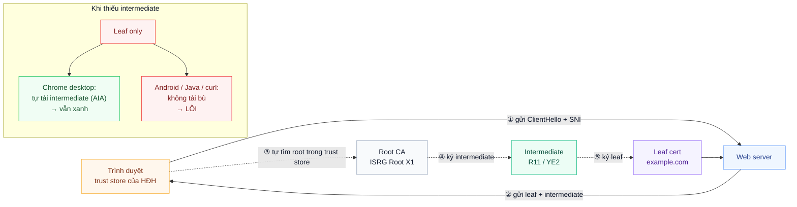
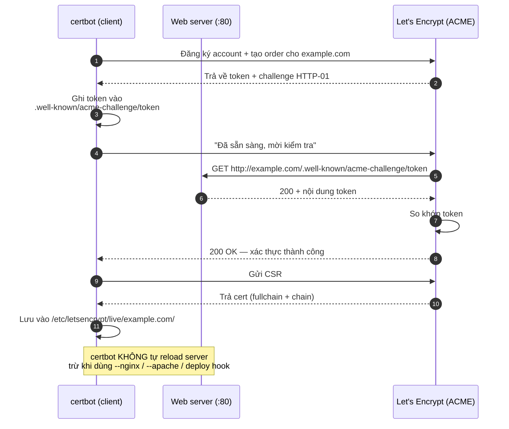
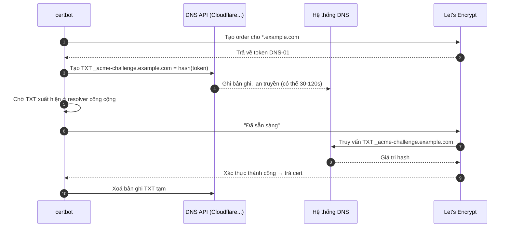
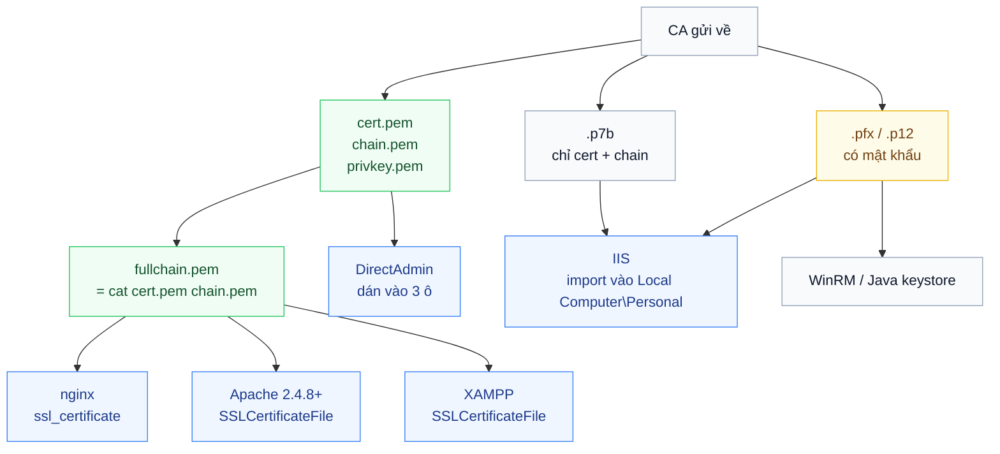
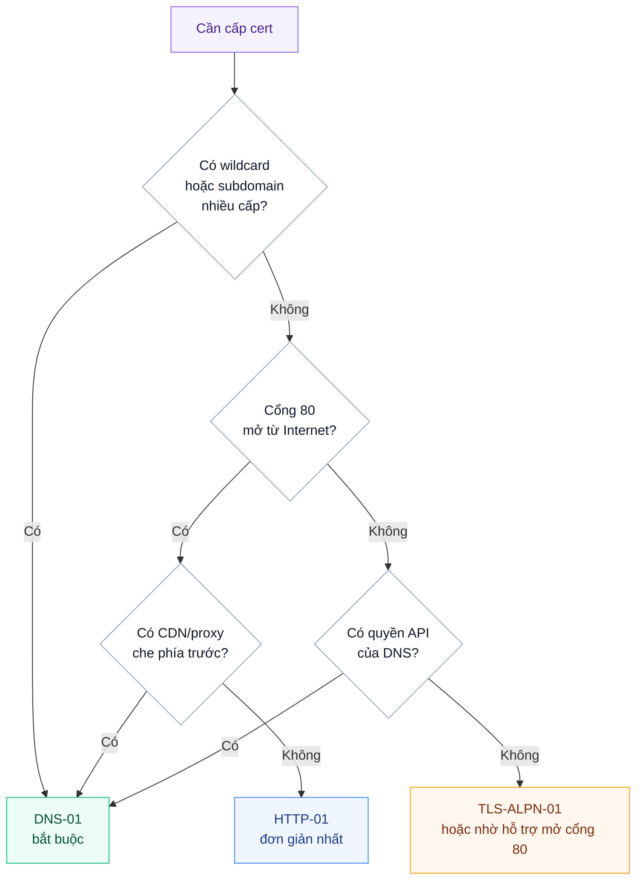
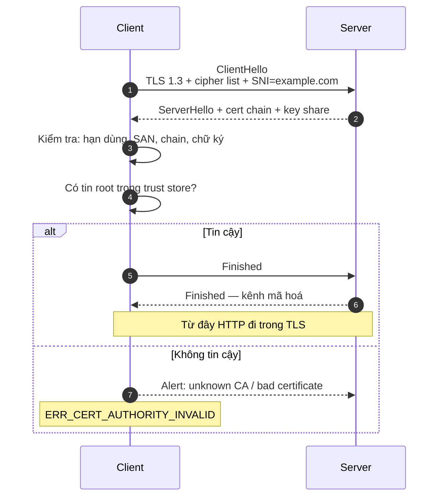
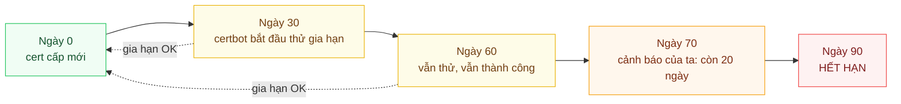
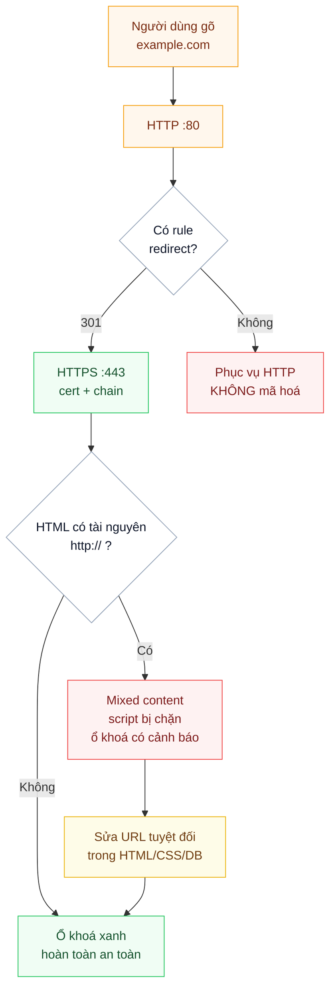
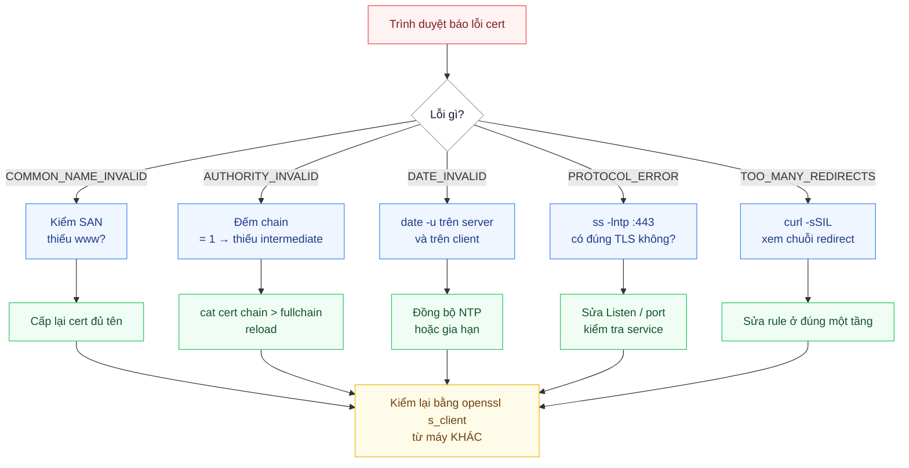
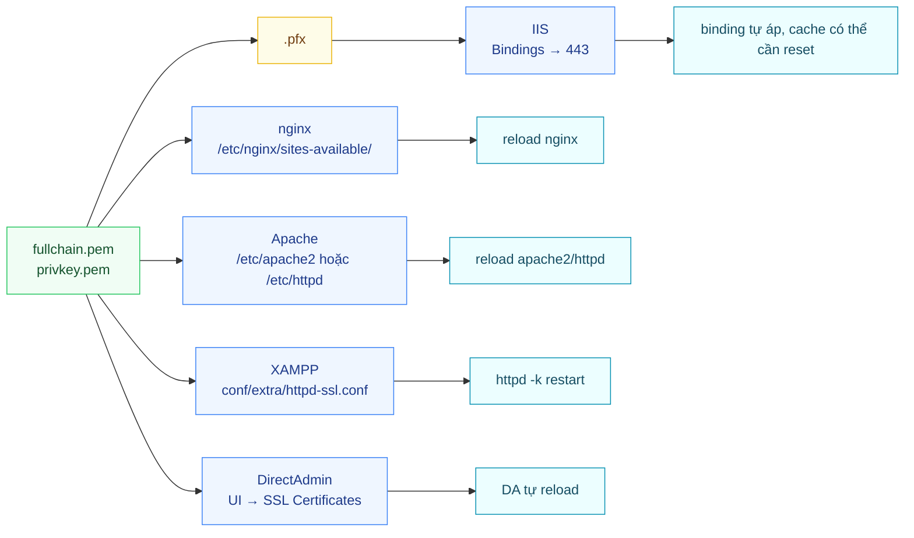

# Sơ đồ: SSL/TLS từ xin cert đến gia hạn

Bộ sơ đồ cho playbook [Cài SSL/TLS](../README.md). Tất cả vẽ bằng **Mermaid** — GitHub render
thành hình ngay trong trang, không cần cài gì. Muốn sửa thì sửa text, không phải sửa ảnh.

> [!TIP]
> Hai sơ đồ quan trọng nhất có thêm **bản động SVG** (mũi tên chảy, gói tin di chuyển):
> [chain-of-trust.svg](img/chain-of-trust.svg) · [acme-flow.svg](img/acme-flow.svg).
> Sinh lại bằng `python3 tools/gen_diagrams.py` — sửa script, đừng sửa tay `.svg`.

| # | Sơ đồ | Trả lời câu hỏi |
|---|---|---|
| 1 | [Chain of trust](#1-chain-of-trust) | Vì sao thiếu intermediate lại lỗi? |
| 2 | [ACME HTTP-01](#2-acme-http-01) | Certbot làm gì khi xác thực qua cổng 80? |
| 3 | [ACME DNS-01](#3-acme-dns-01) | Wildcard hoạt động thế nào? |
| 4 | [File nào đi vào đâu](#4-file-nào-đi-vào-đâu) | `fullchain` hay `cert`, `pfx` hay `pem`? |
| 5 | [Chọn cách xác thực](#5-chọn-cách-xác-thực) | HTTP-01, DNS-01 hay TLS-ALPN? |
| 6 | [TLS handshake](#6-tls-handshake) | SNI, cert, key exchange xảy ra lúc nào? |
| 7 | [Vòng đời 90 ngày](#7-vòng-đời-90-ngày) | Khi nào certbot thật sự gia hạn? |
| 8 | [Redirect và mixed content](#8-redirect-và-mixed-content) | Ổ khoá xanh nhưng vẫn "not secure"? |
| 9 | [Chẩn đoán sự cố](#9-chẩn-đoán-sự-cố) | Cert lỗi thì kiểm tra theo thứ tự nào? |
| 10 | [Bản đồ nền tảng](#10-bản-đồ-nền-tảng) | Cùng một cert, mỗi server cần gì? |

---

## 1. Chain of trust



**Điều cần nhớ:** máy bạn test bằng Chrome **không đại diện** cho client thật. Luôn đếm chain bằng
`openssl s_client -showcerts | grep -c 'BEGIN CERTIFICATE'` — phải bằng 2.

---

## 2. ACME HTTP-01



**Ba điều kiện để bước 6 thành công:** DNS đúng, cổng 80 mở, và không có gì chặn
`/.well-known/` (rewrite, `.htaccess`, WAF, Cloudflare proxy).

---

## 3. ACME DNS-01



**Vì sao cần cách này:** cổng 80 có thể đóng, server có thể không có IP công cộng, và **chỉ DNS-01
cấp được wildcard**.

---

## 4. File nào đi vào đâu



Quy tắc một dòng: **web server nhận `fullchain` + `privkey`; Windows nhận `.pfx`.**

---

## 5. Chọn cách xác thực



---

## 6. TLS handshake



`SNI` là lý do một IP có thể phục vụ nhiều cert. Nếu client không gửi SNI (hoặc gửi sai hostname),
server trả cert mặc định — và trình duyệt báo `COMMON_NAME_INVALID` dù cert hoàn toàn hợp lệ.

---

## 7. Vòng đời 90 ngày



**Đọc sơ đồ này đúng cách:** certbot thử gia hạn từ ngày 30, không phải ngày 89. Nếu tới ngày 70 mà
cert vẫn chưa đổi, nghĩa là **đã thất bại 40 ngày** — đó là lúc cảnh báo phải nổ, không phải lúc
cert hết hạn.

---

## 8. Redirect và mixed content



---

## 9. Chẩn đoán sự cố



---

## 10. Bản đồ nền tảng



---

## Bản ASCII (đọc offline, không cần Mermaid)

### Chain of trust

```text
  Trình duyệt                Web server                 CA
  ───────────                ──────────                 ──
  ClientHello  ──────────────▶
  (SNI=example.com)
                              ◀──── leaf + intermediate
  kiểm tra hạn/SAN/chain
  tìm root trong trust store
        │
        └── root (ISRG Root X1) ký ──▶ intermediate (R11) ký ──▶ leaf

  Thiếu intermediate:
    Chrome desktop → tự tải bù (AIA)  → vẫn xanh
    Android/Java   → không tải bù     → LỖI
```

### Chọn cách xác thực

```text
  wildcard / subdomain 2 cấp? ── có ──▶ DNS-01
           │ không
           ▼
  cổng 80 mở? ── không ──▶ có quyền API DNS? ── có ──▶ DNS-01
           │ có                              └ không ─▶ TLS-ALPN-01
           ▼
  sau CDN/proxy? ── có ──▶ DNS-01
           │ không
           ▼
       HTTP-01
```

### Một cert đi vào đâu

```text
  CA ──▶ cert.pem ─┐
        chain.pem ─┴──▶ fullchain.pem ──┬──▶ nginx:    ssl_certificate
                                        ├──▶ Apache:   SSLCertificateFile
                                        ├──▶ XAMPP:    SSLCertificateFile
                                        └──▶ DA:       dán 3 ô trong UI

  CA ──▶ cert.key ─────────────────────────▶ privkey.pem (chmod 600)

  CA ──▶ .pfx ──▶ IIS: import Local Computer\Personal ──▶ Binding 443
```
